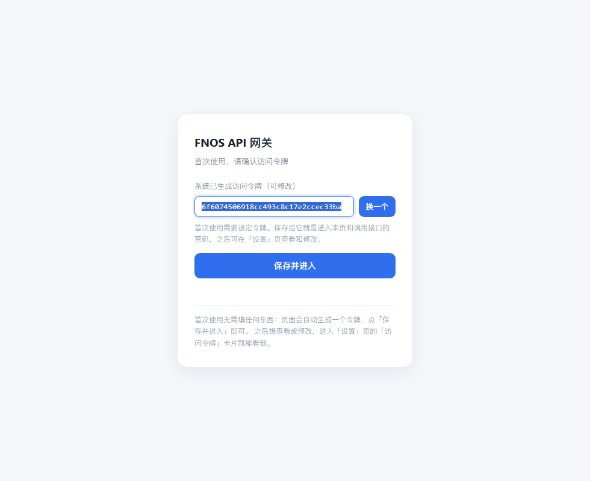
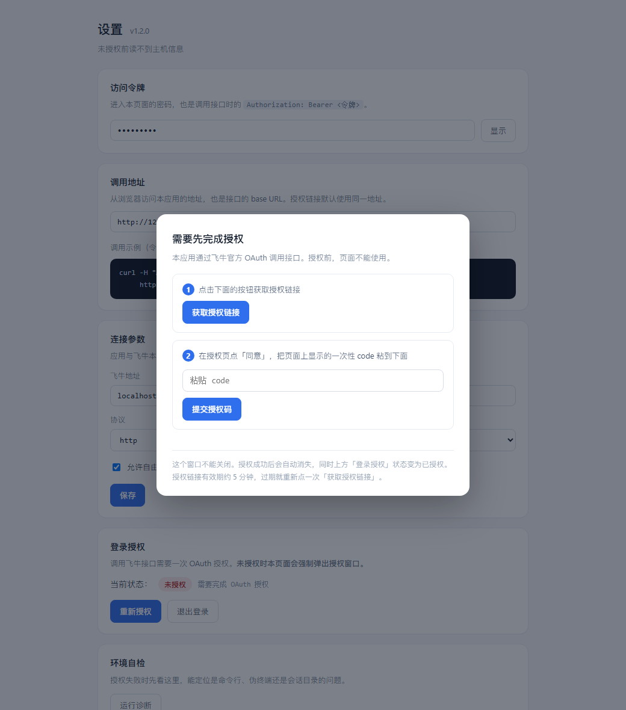
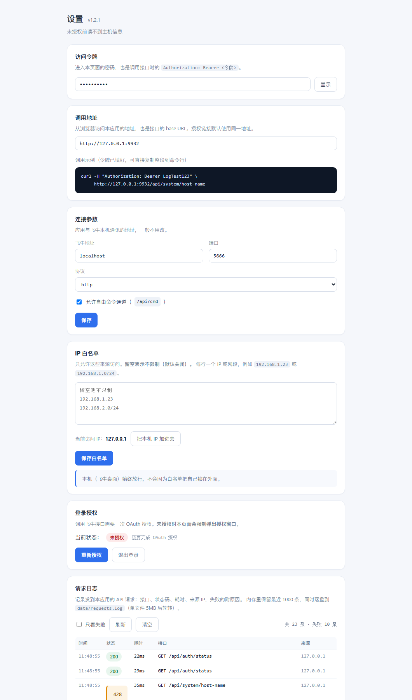

# FNOS-API

把飞牛（fnOS）自带的命令行工具 `trim-cli` 封装成 **HTTP 接口**的飞牛原生应用。

装好之后，用浏览器、脚本或任何语言发一条请求，就能读系统状态、管文件和用户、控制应用与 Docker，不必登录 SSH。

- **170 个接口**，覆盖 `trim-cli` 的全部能力
- 单文件二进制 + 网页设置页，无外部依赖
- Bearer 令牌鉴权，支持 IP 白名单和请求日志
- 通过飞牛应用中心安装，首次打开自动生成访问令牌



## 截图

| 设置页 | 请求日志 |
|---|---|
|  |  |

## 功能

| 模块 | 接口数 | 能做什么 |
|---|---:|---|
| 文件 | 42 | 列目录、搜索、属性、复制移动改名、上传、压缩解压、改属主、ACL、回收站、收藏、团队空间、共享、下载链接 |
| 系统 | 24 | 系统信息、版本、主机名、运行时长、卷、硬件、电源计划、原始请求透传 |
| 存储 | 22 | 存储池、磁盘、S.M.A.R.T.、挂载卸载、建池、加盘换盘扩容、格式化 |
| 监控 | 14 | CPU / 内存 / 网络 / 磁盘 / 进程 / 温度 |
| Docker | 12 | 容器与镜像的查、建、启停、删除，Compose 列表 |
| 下载 | 10 | 任务列表、添加（URL / 本地路径）、暂停恢复、重试、删除 |
| 用户 | 9 | 用户增删改、改名、改密、管理员、冻结解冻、用户组与成员 |
| 应用 | 7 | 应用列表与状态、启停、检查更新 |
| 日志 | 7 | 系统日志查询、模块字典、导出、清空、调试日志采集 |
| 其它 | 23 | 认证授权、设备信息、相册、百度网盘、电源、请求日志、通用命令通道 |

高风险操作（建存储池、加盘换盘扩容、清空回收站、清空日志）需要显式传 `"confirm": true`。

## 安装

1. 到 [Releases](https://github.com/heijiangangqin/FNOS-API/releases) 下载最新的 `.fpk`
2. 飞牛 NAS → 应用中心 → 手动安装，选择该文件
3. 安装过程不需要填任何参数

## 首次使用

安装后在飞牛桌面打开应用，页面会自动生成一个访问令牌并预填好：


点「保存并进入」即可。这个令牌既是进入网页的密码，也是调用接口的 Bearer 令牌，之后可以在「设置」页查看或修改。

设置页还需要完成一次**飞牛 OAuth 授权**（点「获取授权链接」→ 浏览器同意 → 粘贴 code），授权完成后接口才能读到真实数据。未授权时业务接口返回 `428`。

## 认证

```bash
# 方式一：请求头
curl -H "Authorization: Bearer 你的令牌" http://NAS地址:9932/api/system/host-name

# 方式二：查询参数（方便浏览器直接打开）
http://NAS地址:9932/api/system/host-name?token=你的令牌
```

返回统一结构：

```json
{"success": true, "data": { ... }}
{"success": false, "error": "给人看的一句话", "errmsg": "上游原始报错", "errno": 4100}
```

判断成败看 `success`，不要只看 HTTP 状态码。

状态码约定：

| 码 | 含义 |
|---|---|
| 200 | 成功 |
| 400 | 参数缺失或非法 |
| 401 | 令牌不匹配 |
| 403 | 来源 IP 不在白名单 |
| 404 | 目标不存在 |
| 409 | 状态冲突（如 SSH 已是目标状态、任务已完成） |
| 428 | 需要先完成首次设置 / 飞牛 OAuth 授权 |

## 快速上手

```bash
# 系统信息
curl -H "Authorization: Bearer $TOKEN" http://192.168.1.10:9932/api/system/info

# 列目录
curl -H "Authorization: Bearer $TOKEN" "http://192.168.1.10:9932/api/file/ls?path=/vol1"

# 新建目录
curl -X POST -H "Authorization: Bearer $TOKEN" -H "Content-Type: application/json" \
     -d '{"path":"/vol1/1000/测试目录"}' \
     http://192.168.1.10:9932/api/file/mkdir
```

完整接口清单见 [`docs/使用文档.html`](docs/使用文档.html)。

## 与上一版（v1）的区别

本仓库早期是 **Node.js** 实现，v2 是**用 Go 重写**，两者不兼容：

| | v1（2026-07） | v2（当前） |
|---|---|---|
| 实现 | Node.js 脚本 + node 运行时 | Go 单文件二进制，无运行时依赖 |
| 认证 | 复用 NAS 账号登录 | 独立的 Bearer 令牌，可在页面查看修改 |
| 网页 | 多页控制台（概览/文件/应用/下载/用户/日志/调试） | 只保留「设置」页，其余能力走接口 |
| 授权 | 账号密码 | 飞牛 OAuth（设备码） |
| 接口 | 约 60 个 | 170 个，覆盖 trim-cli 全部子命令 |

## 构建

需要 Go 1.21+ 和 Python 3.8+：

```bash
# 打 FPK 安装包（同时交叉编译 linux/amd64 二进制）
python build.py
# 产物：dist/fnos-api-gw-<版本>.fpk
```

只用二进制、不打应用包：

```bash
cd src && GOOS=linux GOARCH=amd64 CGO_ENABLED=0 go build -trimpath -ldflags "-s -w" -o ../fnos-api-gw .
```

`trim-cli` 二进制需自行放入 `pkg/backend/`（不同 fnOS 版本的 CLI 不通用，建议从目标机器上取）。

## 目录结构

```
src/              Go 源码（main / api / routes / trimcli / config / pty / reqlog / ui 内嵌）
src/ui/index.html 设置页（单文件，无外部依赖）
pkg/cmd/          应用生命周期脚本（install / upgrade / main / uninstall）
pkg/config/       权限与资源配置
icons/            应用图标
build.py          打包脚本
docs/             使用文档、快速上手、测试报告
tests/            接口回归脚本（Python 标准库）
```

## 测试

`tests/` 下两个脚本，在本机对已授权的实例跑：

```bash
NAS_PASS=你的NAS密码 python3 tests/full_test.py   # 170 个接口 + 安全语义，输出 JSON
NAS_PASS=你的NAS密码 python3 tests/func_test.py   # 用户/文件/下载的增改删真实链路
```

最近一次结果见 [`docs/测试报告.html`](docs/测试报告.html)：**245 项，0 失败**（17 项为测试机硬件缺失导致的环境限制）。

## 已知限制

- 依赖目标机器上 trim-cli 的版本，接口以 fnOS 1.2.0800 实测
- 存储池相关操作（建池、加盘、换盘、扩容）会重建阵列，未在自动化测试中执行
- `file/cp` `file/mv` 的第二个参数是**目标目录**，不是文件路径
- 应用中心不支持用命令行安装带向导的包，本应用已去掉向导，可命令行安装

## 免责声明

第三方应用，与飞牛官方无关。涉及数据删除、存储池变更的接口请先在测试机上验证。使用风险自负。

## License

MIT
